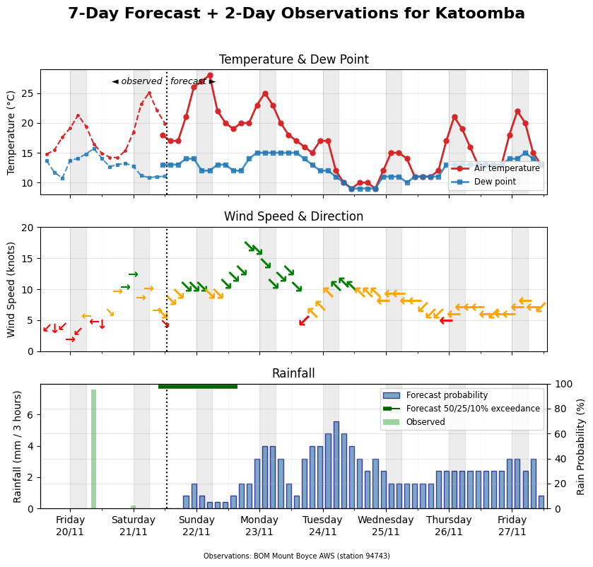
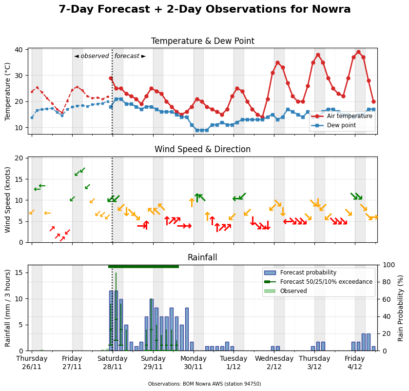
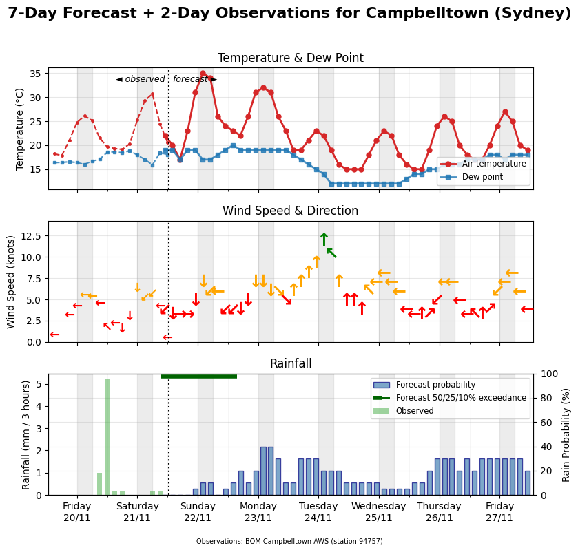



Observations from the last 2 days and 7-day detailed weather forecasts for climbing locations in NSW, with temperature, wind, and rainfall. [About these forecasts](#about-these-forecasts)

  

    Last updated: loading
  

<h2>Katoomba</h2>

  <a href="https://www.bom.gov.au/places/nsw/katoomba/forecast/detailed/" target="_blank">BOM forecast</a> &middot;
  <a href="https://www.bom.gov.au/products/IDN60801/IDN60801.94743.shtml" target="_blank">BOM observations (Mount Boyce)</a>

  

<h2>Nowra</h2>

  <a href="https://www.bom.gov.au/places/nsw/nowra/forecast/detailed/" target="_blank">BOM forecast</a> &middot;
  <a href="https://www.bom.gov.au/products/IDN60801/IDN60801.94750.shtml" target="_blank">BOM observations (Nowra)</a>

  

<h2>Campbelltown (Sydney)</h2>

  <a href="https://reg.bom.gov.au/places/nsw/campbelltown/forecast/detailed/" target="_blank">BOM forecast</a> &middot;
  <a href="https://www.bom.gov.au/products/IDN60801/IDN60801.94757.shtml" target="_blank">BOM observations (Campbelltown)</a>

  

## About these forecasts

These are detailed 3-hourly forecasts for popular climbing locations in NSW, scraped directly from the detailed forecast pages from the old [Bureau of Meteorology](https://reg.bom.gov.au) website. The plots are simply a graphical representation of the underlying tabular forecast data, combined with recent observations from nearby BOM automatic weather stations.

### Update schedule

Forecasts are updated automatically 30 minutes after each BOM forecast issue time:
- **05:30 UTC** (4:30 PM AEDT / 3:30 PM AEST)
- **11:30 UTC** (10:30 PM AEDT / 9:30 PM AEST)
- **17:30 UTC** (4:30 AM AEDT / 3:30 AM AEST)
- **23:30 UTC** (10:30 AM AEDT / 9:30 AM AEST)

### What you're seeing:

- **Temperature & Dew Point**: Red line shows air temperature, blue line shows dew point. Low dew point temperatures indicate low humidity. Dew point temperature is generally a more robust metric to look at than relative humidity (in percentage) because the relative humidity is strongly dependent on air temperature. I.e. the relative humidity generally decreases in the afternoon when the air temperature increases, but this does not actually indicate that there is less water in the air.

- **Wind Speed & Direction**: Arrow symbols show wind direction, with colors indicating speed (red = very light winds less than 5 knots, orange = light winds between 5 and 10 knots, green = moderate winds greater than 10 knots). Higher wind speeds generally lead to better climbing conditions, but this depends on the relative exposure of the cliff you're climbing at compared to the wind direction.

- **Rainfall**: Blue bars show the forecast probability (left axis) of any rain within each 3-hour interval. Green bars show the observed rainfall (right axis, mm per 3 hours). Where BOM provides them (generally only for the next day and a bit), the green vertical lines show the forecast rainfall amount for each 3-hour interval (right axis): the line extends from the amount with a 50% chance of being exceeded up to the amount with a 10% chance of being exceeded. The wide and narrow cross lines mark the 50% and 25% exceedance amounts respectively. The thick green bar along the top of the panel marks the times for which BOM provides these amounts; within it, no line means the forecast rainfall amount is zero, but beyond it (typically more than a day and a bit ahead) no amounts are forecast, so a lack of lines there does not mean that no rain is expected.

The gray shaded areas indicate the typical afternoon climbing period between midday and 6pm.

### Observations

The last 2 days of observations are shown to the left of the dotted vertical line, which marks the time the plots were generated; the forecast is shown to the right. Observations are from the nearest BOM automatic weather station that reports the full set of measurements:

- **Katoomba**: [Mount Boyce](https://www.bom.gov.au/products/IDN60801/IDN60801.94743.shtml)
- **Nowra**: [Nowra](https://www.bom.gov.au/products/IDN60801/IDN60801.94750.shtml)
- **Campbelltown**: [Campbelltown](https://www.bom.gov.au/products/IDN60801/IDN60801.94757.shtml)

The stations report roughly every 30 minutes. To match the forecasts, the observations are averaged into the same 3-hour intervals, plotted at the end of each interval (matching how the forecast times are labelled), and intervals with fewer than three observations are omitted. Air temperature and dew point are dashed lines, wind arrows show the average wind direction and speed over the interval, and rainfall is the total over the interval. Note that the stations can be some distance from, and at a different elevation to, the climbing areas, so conditions at the crag may differ (Mount Boyce is on the plateau near Blackheath, for example).
